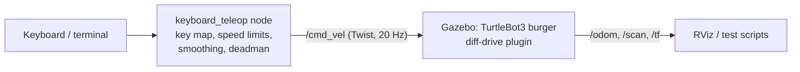
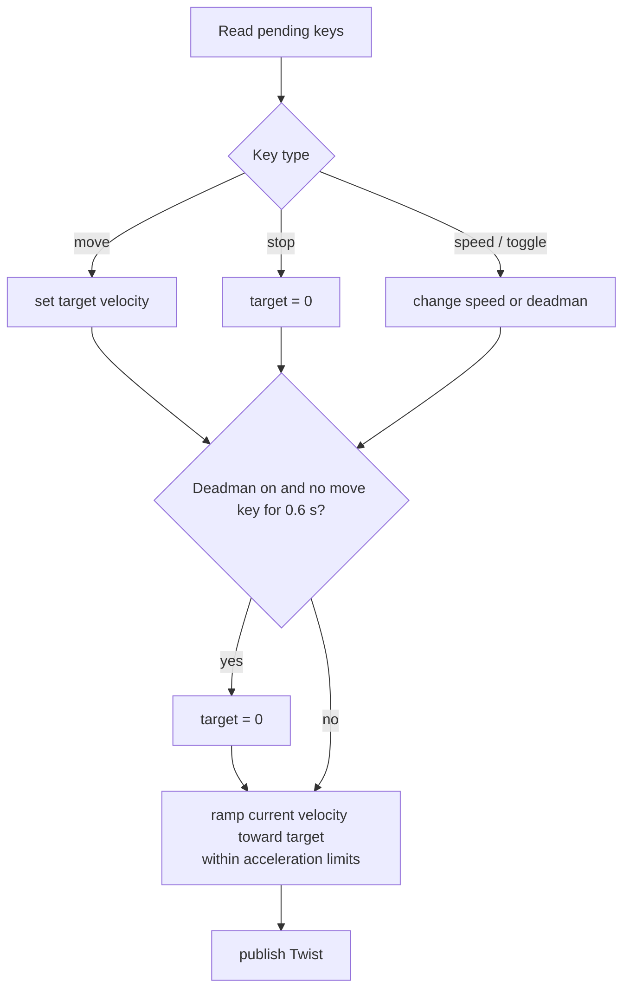

# Keyboard-Based Teleoperation of a Simulated TurtleBot3

Author: Akshat Angi - ROS 2 & Robotics Simulation, individual project (option 2)

## Aim
Control a simulated TurtleBot3 with keyboard commands and test different movement commands.

## Problem statement
A robot is commanded by velocity messages. The task is to turn key presses into safe, smooth
`/cmd_vel` commands for a simulated TurtleBot3 and to show by test that each command produces the
expected motion.

## Software and tools
ROS 2 Humble, Gazebo Classic 11, TurtleBot3 burger (`turtlebot3_gazebo`), Python 3, colcon, pytest.
Optional: RViz2. All are open source (see ATTRIBUTION.md).

## Methodology
1. Set up ROS 2 + Gazebo + TurtleBot3 and confirm `/cmd_vel`, `/odom`, `/scan` exist.
2. Write the key handling as pure Python (`teleop_logic.py`) so it can be unit-tested without ROS.
3. Wrap it in a ROS 2 node that reads the terminal and publishes `Twist` at 20 Hz.
4. Test: unit tests, an automated simulation test, and a test that types real keys into the node.

## System architecture

Control loop in the node (every 50 ms):

## Implementation
- `teleop_logic.py`: `TeleopState.press(key, now)` and `update(now, dt)`. Limits are the burger's
  maximums (0.22 m/s, 2.84 rad/s). Acceleration limits 0.5 m/s^2 and 3 rad/s^2.
- `keyboard_teleop_node.py`: terminal in cbreak mode, non-blocking read, publishes `/cmd_vel`
  (plain `Twist` on Humble). Publishes a final zero command on exit.
- `sim.launch.py`: includes `gazebo_ros` (gzserver, optional gzclient), the TurtleBot3
  `robot_state_publisher` and spawn launch files.
- `scripted_test.py`: replays one key per command through the same logic, publishes to `/cmd_vel`,
  and compares `/odom` before and after, paced on simulated time.
- `scripts/pty_keyboard_test.py`: starts the real node in a pseudo-terminal and types keys.

## Results
Tested in: x86_64 Ubuntu 22.04 container, ROS 2 Humble + Gazebo Classic 11.15 (conda-forge/RoboStack),
turtlebot3_gazebo 2.3.8, empty world, burger.

Unit tests: 11 passed.

Scripted simulation test (`docs/scripted_test_run.txt`), 7 of 7 passed:

| Command | Measured |
|---|---|
| forward (w), 3 s | 0.34 m forward, no rotation |
| backward (s), 3 s | 0.34 m backward, no rotation |
| rotate left (a), 1.5 s | +1.44 rad |
| rotate right (d), 1.5 s | -1.44 rad |
| forward-left arc (q), 1.5 s | 0.16 m, +1.42 rad |
| forward-right arc (e), 1.5 s | 0.16 m, -1.43 rad |
| stop (space) | stays still after ramp-down |

Real-keyboard-node test (`docs/pty_keyboard_test_run1.txt`, `..._run2.txt`), 8 of 8 passed in both runs:
holding w moves forward (0.36 m), the deadman stops the robot when keys stop, a turns left, s reverses,
space stops, u changes speed, the robot is stopped after CTRL-C, and the node exits cleanly.
Distances vary with how fast the simulator runs relative to the clock used by the test, so they are
checked against thresholds, not exact values.

Screenshots of Gazebo were taken from `gzclient` on a virtual display. The close views
`docs/robot_before.png` and `docs/robot_after.png` show the burger before and after a direct
`/cmd_vel` command (0.03 m/s forward for about 4 seconds), with the camera unchanged and LiDAR rays
hidden for clarity. This pair demonstrates simulation motion, not a person typing. Earlier wide
views with LiDAR rays are also kept. The keyboard path is checked separately by the test logs.

A bug found by testing: CTRL-C raised an error before the final stop command was published. Fixed
by handling the interrupt in the node.

## Limitations
- Tested on the Humble/Gazebo Classic stack only, not on an ARM64 Ubuntu VM or with apt-installed packages.
- No collision or obstacle avoidance: the operator is responsible for not driving into walls.
- The deadman relies on terminal key-repeat, so a very slow repeat delay could stop the robot briefly.
- Only the burger model was tested. Gazebo Classic reached end of life in January 2025.
- Test pass thresholds are simple; they check direction and rough size, not precise odometry.

## Conclusion
A keyboard node with smoothing, speed limits, a deadman timeout and a safe shutdown drives a simulated
TurtleBot3, and the movement commands were checked against odometry in a running simulation.

## References
- ROS 2 Humble docs: https://docs.ros.org/en/humble/
- Gazebo Classic: https://classic.gazebosim.org/
- TurtleBot3 simulation (ROBOTIS e-Manual): https://emanual.robotis.com/docs/en/platform/turtlebot3/simulation/
- turtlebot3_simulations: https://github.com/ROBOTIS-GIT/turtlebot3_simulations
- teleop_twist_keyboard: https://github.com/ros2/teleop_twist_keyboard
- RoboStack: https://robostack.github.io/
